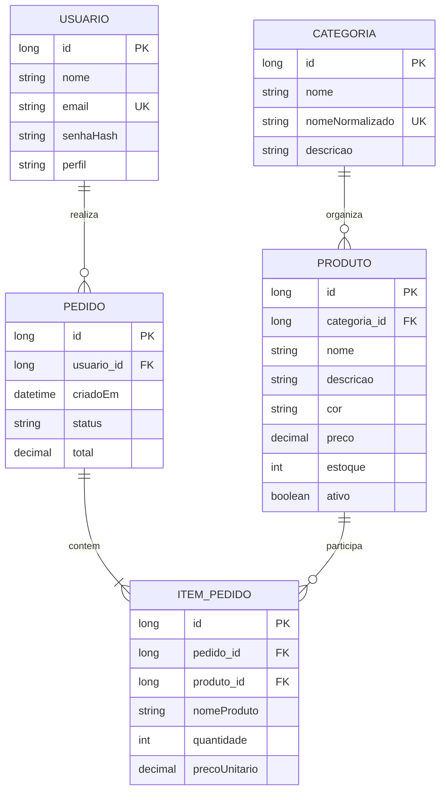

# Modelo de dados e API

## Entidades e relacionamentos



Cada produto pertence a exatamente uma categoria; uma categoria possui zero ou vários produtos. Cada pedido pertence a um usuário e possui pelo menos um item, conforme validação do Service. Cada item referencia exatamente um produto. O produto pode participar de vários pedidos. `ItemPedido` resolve a participação de vários produtos em vários pedidos e registra a quantidade e o preço histórico.

O relacionamento obrigatório 1:N está explicitamente mapeado com `@OneToMany` em `Categoria.produtos` e `Pedido.itens`, e `@ManyToOne` no lado correspondente. Os Controllers recebem/retornam DTOs: não existe serialização das entidades nem recursão JSON entre as associações.

## Percurso de uma requisição

O Spring Security valida o token antes do Controller. O Controller valida o formato do DTO e delega ao Service. O Service aplica as regras e usa o Repository; a persistência fica sob responsabilidade do Spring Data JPA. O Service converte os dados para os records de resposta dentro da transação, permitindo manter `open-in-view=false`.

## Endpoints

Todos os endereços abaixo começam com `/api`. Envie `Authorization: Bearer TOKEN`, exceto nos endpoints de login/cadastro.

| Método | Endpoint | Perfil | Retorno principal |
| --- | --- | --- | --- |
| POST | `/auth/cadastro` | Público | 201, usuário COMUM |
| POST | `/auth/login` | Público | 200, JWT e usuário |
| GET | `/auth/me` | Autenticado | 200, usuário atual |
| POST | `/categorias` | ADMIN | 201, categoria e Location |
| GET | `/categorias` | Autenticado | 200, lista |
| GET | `/categorias/{id}` | Autenticado | 200, categoria |
| PUT | `/categorias/{id}` | ADMIN | 200, categoria atualizada |
| DELETE | `/categorias/{id}` | ADMIN | 204, sem corpo |
| GET | `/categorias/{id}/produtos` | Autenticado | 200, filtro no path |
| POST | `/produtos` | ADMIN | 201, produto e Location |
| GET | `/produtos` | Autenticado | 200, lista e filtros |
| GET | `/produtos/{id}` | Autenticado | 200, produto |
| PUT | `/produtos/{id}` | ADMIN | 200, produto atualizado |
| DELETE | `/produtos/{id}` | ADMIN | 204, sem corpo |
| POST | `/pedidos` | Autenticado | 201, pedido com itens e total |
| GET | `/pedidos` | Autenticado | Próprios pedidos; ADMIN vê todos |
| GET | `/pedidos/{id}` | Proprietário ou ADMIN | 200, detalhes |
| PATCH | `/pedidos/{id}/cancelar` | Proprietário ou ADMIN | 200, pedido cancelado |

## Requests e filtros

Categoria:

```json
{"nome":"Papelaria","descricao":"Materiais de estudo"}
```

Produto:

```json
{
  "nome": "Caneta gel",
  "descricao": "Ponta fina de 0,7 mm",
  "cor": "Azul",
  "preco": 7.90,
  "estoque": 20,
  "ativo": true,
  "categoriaId": 1
}
```

Login:

```json
{"email":"admin@loja.com","senha":"Admin123!"}
```

Pedido (use IDs existentes):

```json
{"itens":[{"produtoId":1,"quantidade":2},{"produtoId":2,"quantidade":1}]}
```

O pedido não aceita preço, total, status ou usuário no request. O usuário vem do token; os valores são calculados no servidor.

| Consulta | Finalidade |
| --- | --- |
| `GET /api/categorias/1/produtos` | Produtos da categoria indicada no path |
| `GET /api/produtos?nome=caneta&cor=azul` | Combinar nome e cor |
| `GET /api/produtos?categoriaId=1&precoMin=5&precoMax=50&ativo=true` | Combinar categoria, faixa de preço e situação |
| `GET /api/categorias/1/produtos?nome=caneta&cor=azul` | Combinar filtro do path e parâmetros |

Nome e cor fazem busca por trecho, sem distinguir maiúsculas/minúsculas. Caracteres `%` e `_` são tratados literalmente. Quando nenhum parâmetro é informado, a lista contém todos os produtos. O catálogo do front envia `ativo=true`; a administração permite visualizar os inativos.

## Erros

| HTTP | Situação |
| --- | --- |
| 400 | Campos inválidos, preço negativo, formato incorreto, produto repetido no pedido ou campo não previsto no DTO |
| 401 | Falta de login, credenciais inválidas ou token inválido/expirado |
| 403 | Perfil sem permissão ou tentativa de acessar pedido de outro usuário |
| 404 | Recurso inexistente |
| 409 | Nome/e-mail duplicado, vínculo que impede exclusão, estoque insuficiente ou pedido já cancelado |

O corpo segue `ProblemDetail`, com `status`, `title` e `detail`. Erros de Bean Validation incluem um mapa `erros` com os campos. As respostas não incluem SQL, stacktrace ou senha hash.

## Decisões de escopo

O objetivo é demonstrar a integração exigida pela disciplina. Há catálogo, estoque simples, carrinho e pedidos. Não há pagamento, frete ou integração fiscal. O carrinho é temporário e fica na memória da aplicação; usuários, categorias, produtos, pedidos e itens ficam no banco. O front usa proxy `/api`, tanto no desenvolvimento quanto no Nginx, mantendo as chamadas no mesmo domínio.
